# How the terrain was made

This is the story of the map's terrain: how it gets from satellite data downloaded off the
internet to the picture you see on screen, and why it was built the way it was. It covers what
goes in, what the terrain tool does with it, what comes out, and how the game draws it. If you're
looking for a specific command or setting, `tools/terrain/README.md` lists them all; this document
explains the thinking behind them.

```
 raw data  (terrain-sources/: downloaded once, used only for baking, never shipped)
     │
     │   terrain bake     recipes/base_earth.json     → heights                         about 18 min
     │   terrain surface  recipes/base_surface.json   → kind of ground, water, colour,
     │                                                   colour detail                   about 30 min
     ▼
 baked tiles  (data/base/: shipped with the game, 2.7 GB)
     │
     │   the game loads data/base, then each mod in mods/ on top
     ▼
 the game picks the tiles the camera needs and draws them
```

## The raw data sources

Everything on the map comes from a handful of free datasets. You download them once into
`terrain-sources/`, a folder that sits next to `tns-godot/`. Only the terrain tool ever reads them,
when it bakes the map, and they never ship with the game (git ignores the folder too). The download
scripts live in `tools/terrain`, and you can stop any of them halfway and run it again later
without losing anything. The credits that the licences ask for are in `CREDITS.md`.

| Source | What it is | How detailed | What it's used for | Good to know | How to get it | Folder and size | Licence |
| --- | --- | --- | --- | --- | --- | --- | --- |
| **NOAA ETOPO 2022** | The height of every point on Earth, including the sea floor, from the US National Oceanic and Atmospheric Administration. The "ice surface" version is used, so Greenland and Antarctica are the top of the ice rather than the rock underneath. | A point every 463 m (15 arc-seconds), in 288 files that each cover 15° by 15°. | The heights of the whole world down to level 7 (611 m), plus level 8 in dune seas and rocky plateaus. Its sea depths also tell the game how dark to make the sea, and decide what's land and what's sea wherever WorldCover has no data. | Anything below sea level, like the shore of the Dead Sea or the Caspian lowlands, gets raised to 0 m in the height pack. That's because the water pack is what draws water, not the heights. | `download_etopo2022.ps1` | `etopo2022_15s`, 4.9 GB | Public domain |
| **Copernicus GLO-90** | A much sharper height map of the land, made from the TanDEM-X radar satellites by the EU's Copernicus programme. | A point every 92 m (3 arc-seconds), one file per 1° by 1° square. | The finest heights (level 9, 153 m), but only in 2,619 squares: the 2,000 steepest places in the world (found by `terrain rugged`, so the Alps, the Himalaya, the Andes and so on), and 632 squares of dunes and rock with lots of hidden relief (found by `terrain bland`, like the Namib dunes). | Radar sees the top of whatever is there, so treetops and buildings are included in the heights. At 92 m you can't tell. Downloading it for all the world's land would be about ten times as big. | `download_copernicus90.ps1 -List <list>`, which only fetches the squares on the list | `copernicus_glo90`, 9.8 GB | Free to use with a credit line |
| **ESA WorldCover 2021** | A map from the European Space Agency that says what every 10 m of land is: tree, shrub, grass, crop, built-up, bare, snow and ice, water, wetland, mangrove or moss. It was made from the Sentinel-1 and Sentinel-2 satellites in 2021. | The original is 10 m and 115 GB. Each file also holds smaller copies of itself, and only one of those is downloaded. It's called the "160 m" copy but is really 148 m (2,250 pixels per 3°), which is about the same as the finest tiles (153 m). 2,651 files of 3° by 3°. | Most of the map: the land cover pack, the water pack (coasts, lakes and rivers), the distant colour pack (the mix of kinds of ground at each point), measuring the colour of each kind of ground, and the search for ground texture samples (`terrain samplepick`). | It stops at about 82.8° N and leaves out Antarctica and the open sea. At 148 m, anything narrower than about 100 m (most small rivers, roads and villages) disappears, so don't be surprised if a small river is missing up close. "Built-up" counts every road and village, so even plain farmland is 1 to 3% built-up. And it lumps sand seas, rock plateaus, gravel plains and salt flats together as "bare", which is why the deserts needed the colour detail (decision 14). | `download_worldcover.ps1` (needs GDAL) | `worldcover_160m`, 1 GB | CC BY 4.0, credit required |
| **Natural Earth glaciers** | Outlines of the world's glaciers and ice caps, from the free Natural Earth map data (the 1:10 million "glaciated areas"). | Outlines on a map rather than a grid of points. | Filling in the far north, beyond 82.8° N, where WorldCover has nothing: the north coasts of Greenland and Ellesmere Island. Inside an outline is ice, outside is bare ground. | `make_arctic_cover.ps1` turns the outlines into files that look just like WorldCover's, in `worldcover_arctic` (0.4 MB). The outlines are rougher than WorldCover, but hardly anyone zooms in that far north. | Download [ne_10m_glaciated_areas.zip](https://naciscdn.org/naturalearth/10m/physical/ne_10m_glaciated_areas.zip) (1.6 MB) and unzip it | `natural_earth`, 6 MB | Public domain |
| **NASA Blue Marble, July 2004** | A cloud-free picture of the whole Earth, which NASA stitched together from a month of MODIS satellite photos. | It comes in two versions, named with rounded-off sizes. The "2 km" one is really 1.85 km a pixel, a single picture of 21,600 by 10,800. The "500 m" one is really 463 m a pixel, in eight tiles of 21,600 by 21,600. | The colour of each kind of ground, place by place (`cover_colours.png`). The tool averages the 2 km picture over about 30 km for each kind, which is how Saharan sand ends up redder than Arabian sand (decision 12). It also feeds the colour detail pack: the 2 km picture everywhere, and the sharper 500 m one wherever the map looked bland up close (decisions 14 and 15). | It's July everywhere, so it's summer in the north and winter in the south. It has the real sun's shadows on the mountains, which would fight with the game's own lighting, so the colours average them away and the detail fades out on steep slopes. North of about 79.5° N it's plain white, so the detail fades out there too. | The 2 km picture: copy it from the Unity project (`Assets/Map/Textures`) or get it from NASA. The 500 m one: `download_bluemarble500.ps1` (needs GDAL) | `bluemarble_2km`, 124 MB; `bluemarble_500m`, 1.9 GB plus 351 MB of the original JPEGs | Public domain |
| **ESA WorldCover Sentinel-2 picture, 2021** | The cloud-free colour picture of the land that WorldCover itself was made from. It's sharp enough to see individual fields. | 10 m, but only small squares are ever read from it: 88 km squares at 1024 by 1024 pixels (86 m a pixel), and some older 44 km ones (43 m a pixel). | Nothing but the close-up ground textures (decision 16). There are 17 squares of 88 km, one per texture, and 39 older 44 km squares, of which only the wetland texture still uses one. | The 88 km squares were picked by `terrain samplepick` as the plainest ground of each kind, then checked by eye. The 44 km desert squares are just being kept in case desert textures ever come back. | The 88 km squares: `download_s2_windows.ps1`. The 44 km ones: `download_s2_samples.ps1` (both need GDAL) | `sentinel2_samples_88km`, 160 MB; `sentinel2_samples`, 360 MB | CC BY 4.0, credit required |

## The packs

The terrain tool bakes the raw data into five **packs**. A pack is a folder of tiles in
`data/base`, and the five together come to about 2.7 GB, which is what ships with the game. Each
pack holds one kind of information, and the game reads all five for every point it draws ("How
the packs are combined" in section 1 explains how they fit together). Every pack folder also has
a `pack.json`, which records how it was baked, and a `decisions.csv`, which records why each tile
was kept or left out. Those two are for people; the game never reads them.

| Pack | What it does | What it's made from | Levels | An example | Good to know | Size |
| --- | --- | --- | --- | --- | --- | --- |
| **Heights** (`terrain`) | Raises the mountains when the map folds into a globe, and drives the slope shading that makes hills look 3D at every zoom. | ETOPO everywhere down to level 7, ETOPO again at level 8 in dune seas and rocky plateaus, and Copernicus at level 9 in its 2,619 squares. Where more than one has data, the sharper one wins. The recipe is `recipes/base_earth.json`. | 0 to 9, so down to a point every 153 m | The slopes of the Matterhorn come from Copernicus at 153 m, while the flat Russian plain stops at a coarser level, because finer tiles there would look exactly the same. | A finer tile is only stored where its slopes look noticeably different from the coarser one above it (decision 1). Heights are rounded to the nearest 2 m, and anything below sea level is raised to 0. | 1.18 GB |
| **Land cover** (`cover`) | Up close, tells the game what each point of land is, so it can draw each kind in its own colour with clean, sharp edges: forest edges, snowlines, towns. It also decides which ground texture goes where. | WorldCover: each point takes whichever kind of ground is most common among the WorldCover pixels under it. North of 82.8° N it uses the Natural Earth glaciers instead, and Antarctica is simply snow. The recipe is `recipes/base_surface.json`. | 7 and 8 everywhere (611 m and 305 m), and 9 (153 m) in hilly and mountainous country, one level finer than the heights there | On a mountainside, the patches of forest, meadow, rock and snow are smaller than the slopes they sit on, so the land cover goes one level deeper than the heights in mountains. | From further out the game draws the distant colour instead. The folder also holds `cover_colours.png`, the colour of each kind of ground all around the world: eleven world maps of 720 by 360 stacked on top of each other (tree, shrub, grass, crop, built, bare, snow, water, wetland, mangrove, moss). It's the easiest file to repaint in a mod. Make the "crop" map more yellow, and every field in the world turns more yellow. | 415 MB |
| **Water** (`water`) | Draws the coastlines, lakes and rivers. | WorldCover's water, plus ETOPO's heights to decide land or sea wherever WorldCover has no data (the open sea, Antarctica and the far north). | 0 to 9 | Each point stores how much of the ground around it is water. A point on a beach that's 60% water counts as sea, and the coast is drawn exactly where the water crosses the halfway mark. That keeps it sharp at every zoom instead of turning into blocky pixels (decision 10). | A finer tile is only stored where it would move the coast by more than 1 km². | 331 MB |
| **Distant colour** (`surface`) | The colour of the land when you're zoomed out, and the colour of the sea at every zoom. | The mix of kinds of ground under each point (from WorldCover), painted with the colours in `cover_colours.png` (from Blue Marble). The sea's shade comes from how deep it is in ETOPO, and any water more than 25 m above sea level is treated as a lake. | 0 to 6 (down to 1.2 km), and 7 (611 m) on open ground that isn't mountains (`open_squares.csv`) | A point that's 70% forest and 30% grass gets 70% of the forest colour and 30% of the grass colour. | Not a single pixel of satellite photo is copied in. That means a big area of one kind, like a desert that's all "bare", comes out as one flat colour. The colour detail is what brings the variety back. | 153 MB |
| **Colour detail** (`detail`) | Brings back the variety inside one kind of ground, both near and far: the Sahara's dark rock plateaus and red sand seas, or the lighter and darker patches of a forest. | The real Blue Marble colour divided by the colour the land cover says should be there. What's stored is a multiplier close to 1 for each of red, green and blue. | 0 to 6 everywhere (from the 2 km picture), and down to 8 (305 m) from the 500 m picture where the map looked bland up close (`detail_fine_squares.csv`), on open ground (`open_squares.csv`) and across whole rainforests (`fill_squares.csv`) | Over a dark rock plateau that's only 60% as bright as the sand colour predicted, the detail is 0.6. The game multiplies the sand colour by 0.6 and the plateau is dark again. | It fades away on steep slopes, where Blue Marble's own shadows are, and north of 79.5° N, where Blue Marble is plain white. It's never drawn on its own, only multiplied onto the land colour. | 655 MB |
| **Ground textures** (`data/base/ground`, not really a pack) | Up close, adds the fine light and dark of real ground: field edges, gullies, the crowns of trees. | The Sentinel-2 picture: one 88 km square of a typical place for each texture (44 km for wetland). | They aren't tiles: there are 5 standard and 14 regional pictures, each 1024 by 1024, laid over every place of their kind. They fade in as you zoom from about 500 km down to 250 km | Farmland in Europe shows the fields of the Beauce in France, and forest north of 52° N shows Russian forest. | Alongside them are `regions.png` and `regions.txt`, which say which region each 1° square belongs to, and `sizes.txt`, which says how much ground each texture covers. Decision 16 explains how they're made and laid. | 39 MB |

**How sharp each pack is compared with its source.** A tile can be coarser than the data it
came from, about the same, or finer. When it's coarser, the tool averages the source under each
point. When it's finer, the tool blends smoothly between the source's points, so the tile looks
smooth but doesn't contain anything the source didn't. Nothing is ever made up. All the distances
below are north to south; east to west, the tiles and the sources both shrink as you move away
from the equator, so the comparison holds everywhere.

| Pack | Level | Source | Source spacing | Tile compared with source | What the tool does |
| --- | --- | --- | --- | --- | --- |
| Heights | 9 (153 m), in 2,619 squares | Copernicus | 92 m | 1.7 times coarser | Averages the source points under each point |
| | 8 (305 m), in dune and rock squares | ETOPO | 463 m | **1.5 times finer** | **Blends between the source points.** It's kept because it's the first level that holds everything ETOPO has; level 7 (611 m) would blur some of it away. |
| | 7 (611 m), everywhere else | ETOPO | 463 m | 1.3 times coarser | Blends between the source points |
| Land cover | 9 (153 m), in hills and mountains | WorldCover, the "160 m" download | 148 m | About the same | Takes the most common kind of ground under each point |
| | 8 (305 m), everywhere else | WorldCover | 148 m | 2 times coarser | Takes the most common kind of ground under each point |
| Water | 9 (153 m) | WorldCover | 148 m | About the same | Counts how much of the ground under each point is water |
| | 9 (153 m), north of 82.8° N and on the open sea | ETOPO, for land or sea | 463 m | **3 times finer** | **Blends between the source points**, though this only matters along the far north coasts |
| Distant colour | 7 (611 m), on open ground | WorldCover's mix of kinds | 148 m | 4 times coarser | Averages. This is deliberate: the variety inside each point comes from the colour detail instead. |
| | 6 (1.2 km), everywhere else | WorldCover's mix of kinds | 148 m | 8 times coarser | Averages |
| The colour of each kind of ground (`cover_colours.png`) | One value per quarter of a degree | Blue Marble "2 km" | 1.85 km | Much coarser | Averages over about 30 km, on purpose, so the photo's shadows cancel out (decision 12) |
| Colour detail | 8 (305 m), in the listed squares | Blue Marble "500 m" | 463 m | **1.5 times finer** | **Blends between the source pixels.** A point halfway between a pixel of 0.8 and one of 1.0 gets 0.9. It's kept because level 7 would blur part of the picture away. |
| | 6 (1.2 km), everywhere else | Blue Marble "2 km" | 1.85 km | **1.5 times finer** | **Blends between the source pixels**, for the same reason |

## Design decisions

These are the choices that shaped the terrain, along with why each one was made and, where it
helps, pictures of the difference. They're grouped by the pack they affected (see "The packs"
above). The first group applies to all of them.

### For all packs

#### 1. Detail only where you can see it

Storing the whole world at the finest detail would take tens of gigabytes, and most of it would
be wasted. Large parts of the world, like the sea, the great plains and the ice sheets, look the
same however far you zoom in. So the terrain is split into tiles at many levels of detail, and a
finer tile is only stored where it would actually change what you see. Everywhere else, the game
just stretches the coarser tile above it. Mountains, coasts and dune seas get fine tiles; the
middle of the ocean stays coarse.

To decide whether a tile "changes what you see", the tool compares slopes, because slopes are
what the slope shading shows. A finer height tile is kept only if its slopes differ from the
coarser tile's by more than 6 m in every 100 m, over more than 800 km² of ground. That one rule
shrank the height pack from 1.7 GB to 714 MB without any loss you could see.

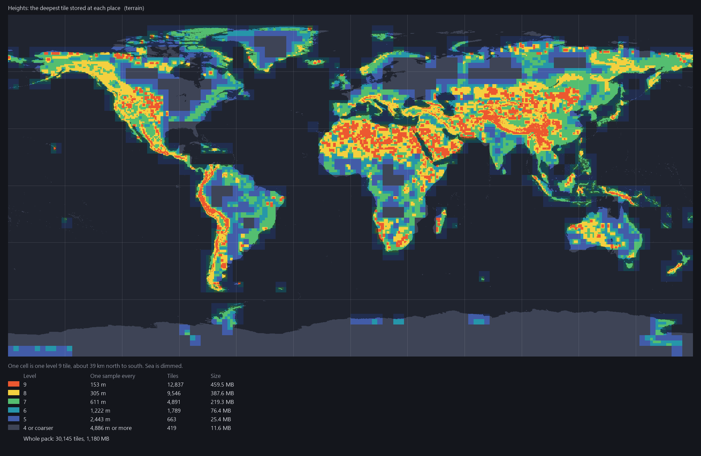

*How much height detail is stored around the world. The mountains go down to the finest level, a
point every 153 m, while the oceans and plains stay coarse. The other maps in `docs/detail_maps`
show the same thing for the other packs.*

Every bake also writes down the measurement behind each of these choices, whether the tile was
kept or not, and a second map for each pack shows it. There's one world map per level, and each
tile is coloured by how much it would change the picture compared with the limit. Blue tiles were
under the limit and left out. (Striped blue ones were kept anyway, for some other reason, such as
a finer tile below them being kept.) Yellow to red tiles were over the limit and kept. Light blue
and yellow are the borderline cases that a small change in the setting would flip.

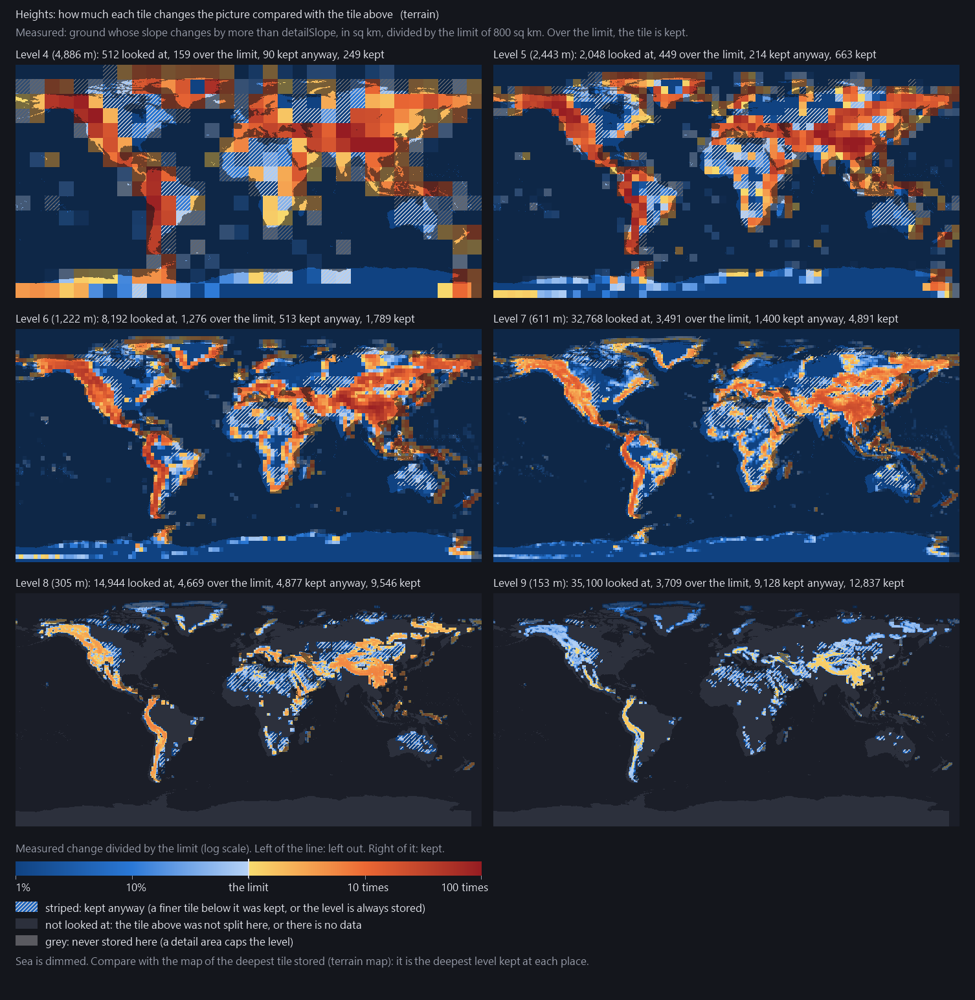

*The measurements behind the height map above. At level 9 (bottom right), only the yellow tiles,
1 to 3 times over the limit, were kept; they're the orange level 9 areas in the first map. Every
pack has the same pair of maps (`docs/detail_maps/*_decisions.png`). If you want the exact
formulas, "What each pack measures" in `tools/terrain/README.md` gives each measurement as an
equation, along with its limit and why that limit was chosen.*

| Pack | When a finer tile is kept | Map of the result | Map of the measurements |
| --- | --- | --- | --- |
| Heights | The slopes change by more than 6 m in 100 m over more than 800 km² | `heights.png` | `heights_decisions.png` |
| Land cover | The kind of ground shown changes over more than 20 km² (level 7 is kept wherever there's land) | `land_cover.png` | `land_cover_decisions.png` |
| Distant colour | The colour changes noticeably (by more than 0.04) over more than 100 km² | `distant_colour.png` | `distant_colour_decisions.png` |
| Water | The coast moves over more than 1 km² | `water.png` | `water_decisions.png` |
| Detail | The detail changes by more than 0.05 over more than 100 km² | `detail.png` | `detail_decisions.png` |

#### 2. Easy to mod

Every pack is just a folder of tiles, and a mod is simply another folder of tiles that replace
the base ones in the same places. A mod only needs to include the tiles it changes. You can even
export the heights as an image, edit them in any image editor and bake them back in. "Modding"
below has the details.

#### 3. Ship the result, not the raw data

The raw data adds up to about 18 GB, but the game only ever reads the baked packs, which are
2.7 GB. So the raw data stays in `terrain-sources/`, outside the game project and outside git.
Godot never sees it, and it never ships.

#### 4. Fixing one area without rebaking the world

Baking the ground for the whole world takes about half an hour. When only one area needs to
change, say to fix bad data or repaint a region, `terrain surface ... --update west,south,east,north`
rebakes just that area in a minute or two and leaves the rest of the map exactly as it was. The
heights can't do this yet.

### For the heights (`terrain`)

#### 5. Mountains at their true height

Mountains are drawn at their real height and never stretched taller. Exaggerating them makes the
world look dramatic, but it's wrong, and the map would no longer match real heights. To keep the
mountains easy to read anyway, the slope shading pretends slopes are three times steeper than
they really are. That only changes how light or dark the slopes look; the ground itself stays at
its true height.

#### 6. Fine heights only for the most interesting ground

The whole world's heights come from NOAA's ETOPO 2022, which has a point every 463 m, includes the
sea floor and is a 4.9 GB download. On top of that, the 2,000 most rugged 1° squares (the mountain
ranges) and the dune seas also get Copernicus heights, which are five times sharper, with a point
every 92 m. Getting Copernicus for all the world's land would be about ten times the download.
These 2,619 squares come to 9.8 GB, and they're exactly the places people love to zoom in on.

#### 7. Real dunes instead of smooth sand

The rule from decision 1 decided that gentle dunes were too slight to be worth keeping. But
because the slope shading makes slopes three times steeper, those dunes would actually show. The
fix is a list of dune seas, rocky plateaus and steppe, found by the bland survey (decision 15),
that are always kept at full detail no matter what the rule says.

| Before: smooth sand | After: real dunes from the height data |
| --- | --- |
| 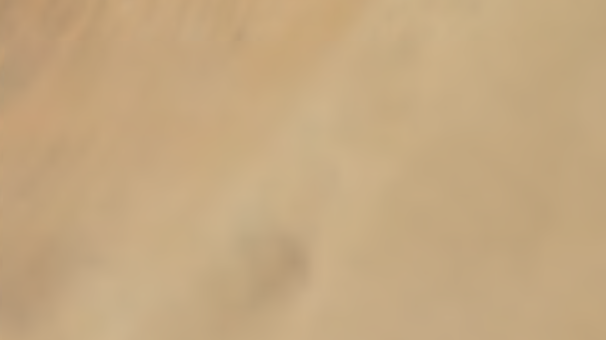 | 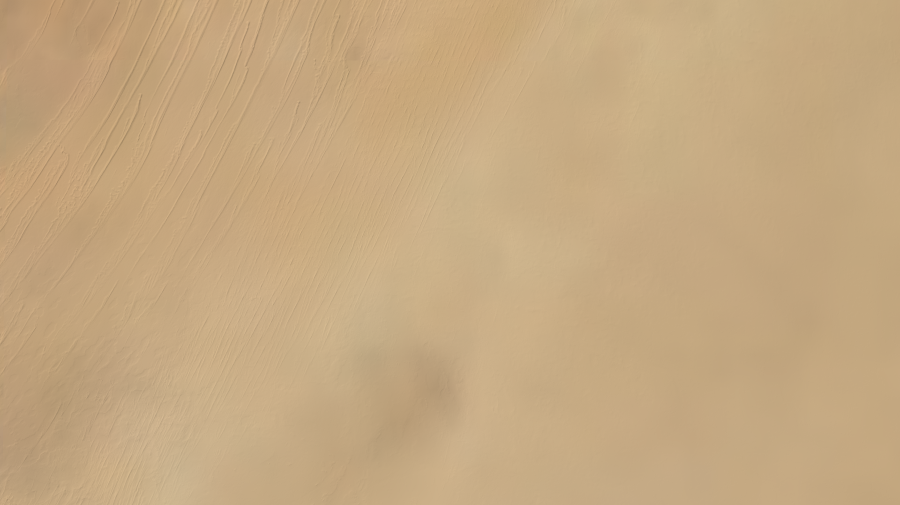 |

*Erg Chech in the Sahara, up close. On the left the dunes had been thrown away; on the right
they're kept, and the slope shading picks out every ridge.*

### For the land cover (`cover`)

#### 8. Draw the ground from what's there, not from a photo

The first version simply laid a NASA satellite photo (Blue Marble) over the globe. Up close it
went blurry, and the sunlight and shadows baked into the photo clashed with the game's own
lighting. Now the ground is drawn from **land cover**: a map of what kind of ground every place
is (forest, grass, farmland, town, bare rock, snow, water, wetland, mangrove, moss), from ESA's
WorldCover 2021. Each kind of ground gets its own colour and clean edges, so coasts, lakes and
rivers stay crisp at any zoom. And nothing repeats or swaps around as you zoom, which was a
problem with the old Unity version's tiled artwork.

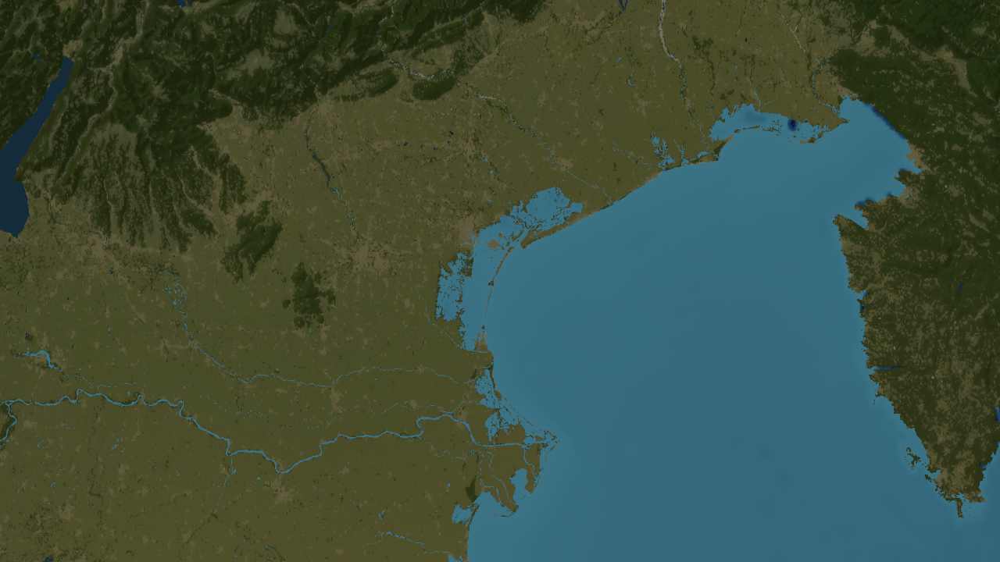

*The Venice lagoon. The coast, the lagoon and the rivers all come from the land cover, so they
stay sharp up close.*

#### 9. A smaller land cover download

WorldCover at its full sharpness, a point every 10 m, is an 11 GB download, which was just too
much. A version shrunk to a point every 160 m is only about 1 GB, and that's still finer than the
game ever draws. In hills and mountains the land cover goes one level finer than the heights (a
point every 153 m in the Alps), because the patches of forest, meadow, rock and snow on a
mountainside are smaller than the slopes they sit on.

#### 10. Sharp edges that aren't pixelated

The first close-up drawing coloured each point by whichever kind of ground was most common there.
In the Alps that looked like a mess of blocky pixels. Now the game blends the kinds of ground
around each point smoothly and then sharpens the result, so the edges are clean but follow the
land in curves.

| Before: blocky | After: smooth but sharp |
| --- | --- |
| 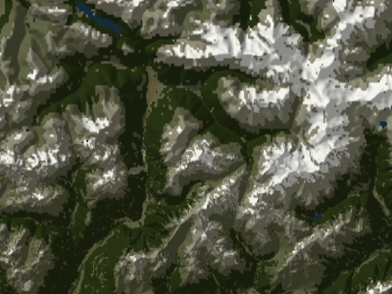 | 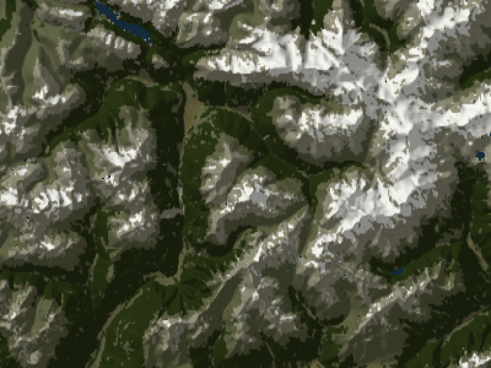 |

*The Alps up close. On the left, the edges of forest, rock and snow are stair-stepped; on the
right they follow the land smoothly.*

#### 11. Filling in the far north

Two of the sources have nothing near the North Pole. WorldCover comes from the Sentinel-2
satellites, which never look further north than about 82.8° N, and Blue Marble turns plain white
north of 80° N. So the north coasts of Greenland and Ellesmere Island came out as water-coloured
land covered in streaks. Now the heights decide what's land and what's sea up there, the ice comes
from Natural Earth's glacier outlines (a 1.6 MB download), everything else is bare ground, and the
colour detail fades out north of 79.5° N. The ice outlines are rougher than WorldCover's, but
hardly anyone zooms in that far north.

| Before | After |
| --- | --- |
| 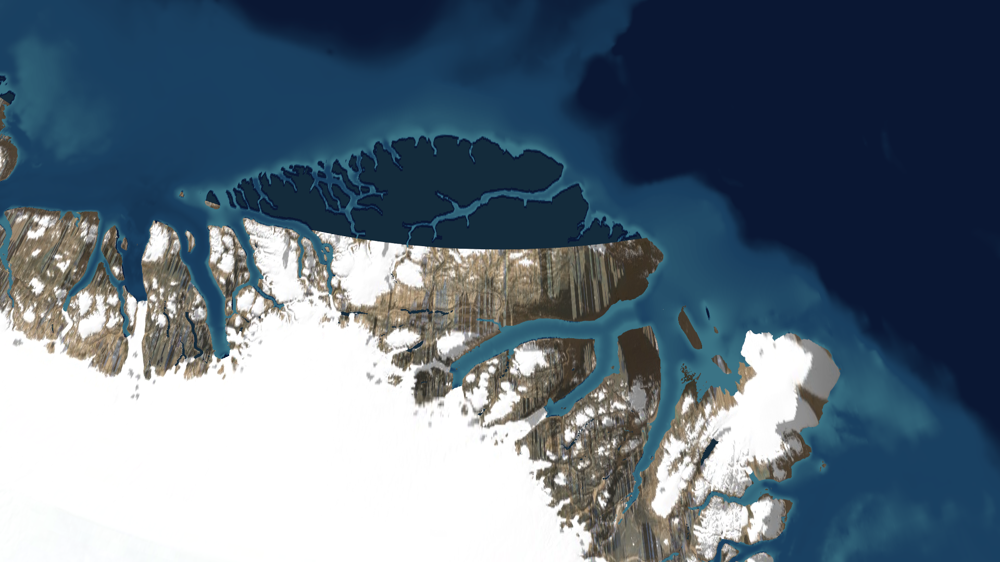 | 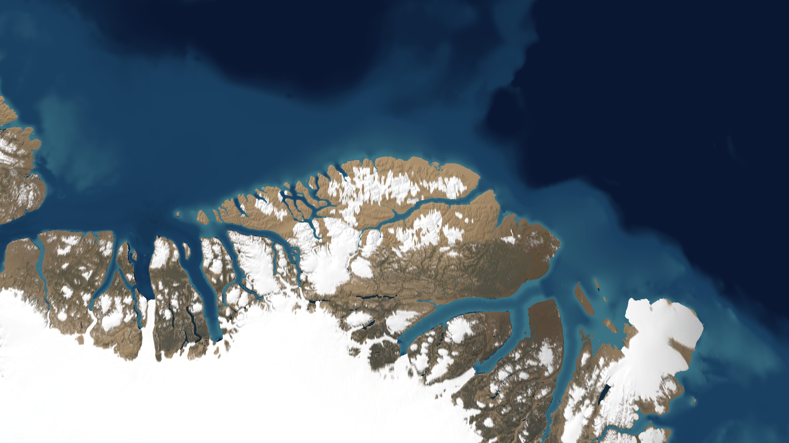 |

### For the water (`water`)

The water pack doesn't have any decisions of its own; it came out of the land cover work. Its
coasts, lakes and rivers come from WorldCover's water and are drawn where the share of water
crosses the halfway mark, which keeps them as crisp as the land cover's edges (decisions 8 and 10).
In the far north, where WorldCover has nothing, the heights decide what's land and what's sea
(decision 11).

### For the distant colour (`surface`)

#### 12. Colours measured from real photos, without their shadows

Every kind of ground needs a colour, and "bare ground" in the Sahara isn't the same colour as in
Arabia. So the tool measures the average Blue Marble colour of each kind of ground, place by
place, over about 30 km. Averaging over that much ground cancels out the photo's shadows, since
slopes face every which way, so the game's lighting is the only lighting you see, while the
regional colour survives. These colours are stored in `cover/cover_colours.png`, which is also the
easiest place to repaint them. The distant colour is made by mixing them, and the land cover is
painted with them up close, so any change you make there shows at every zoom.

#### 13. Sharper world and country views

Most of the game is played zoomed out to about the size of a country, so the distant views matter
most. The distant colour and detail tiles were made twice as sharp: they now use the full 257 by
257 points, and the game switches to a finer tile as soon as one would be more than 256 pixels
wide on screen.

| Before | After |
| --- | --- |
| 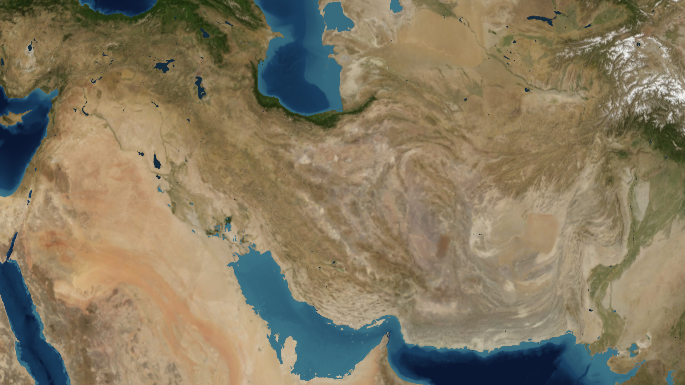 |  |

*Iran at country zoom. The mountain ranges, salt flats and river valleys are crisper on the
right.*

### For the colour detail (`detail`)

#### 14. Bringing back the variety in deserts

With one colour per kind of ground, a whole desert is a single kind ("bare"), so from a distance
it turned into a smooth blur: the Sahara lost its dark rock plateaus and red sand seas. The fix is
the **detail pack**. For every place, it stores how much the real photo's colour differs from the
colour that place's kind of ground predicts, and the game multiplies that difference back in. It
fades away on steep slopes, where the photo's own shadows would otherwise show.

| Before: one smooth blur | After: plateaus, sand seas and wind streaks |
| --- | --- |
| 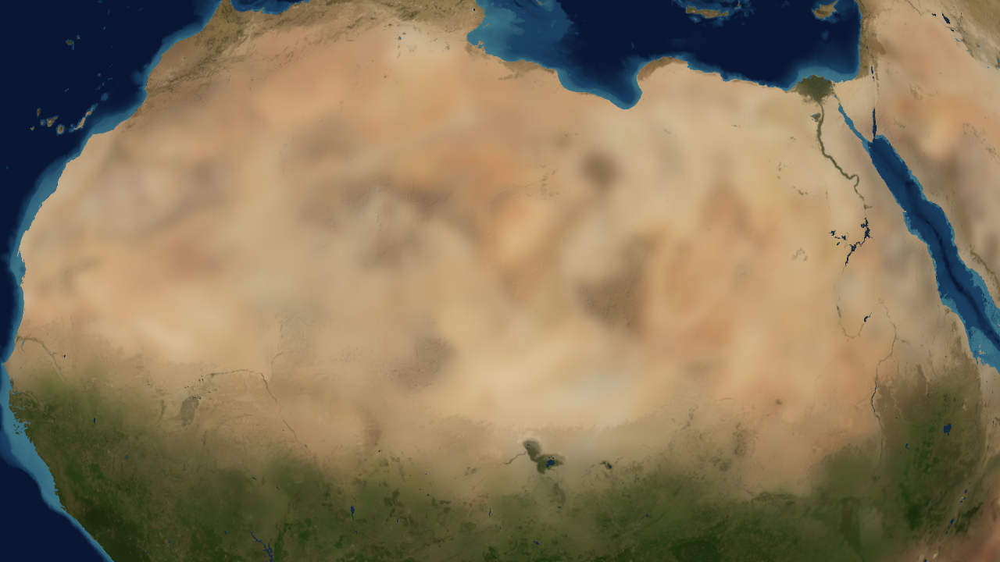 |  |

| Before | After |
| --- | --- |
| 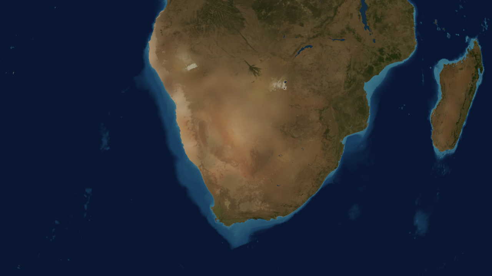 | 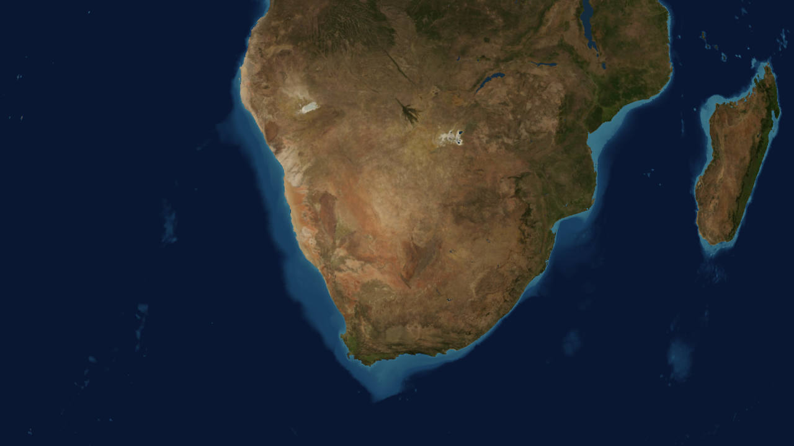 |

#### 15. Sharper photos only where they help

Blue Marble also comes in a sharper version, with a point every 500 m instead of every 2 km
(1.9 GB). To work out where it's worth using, the **bland survey** (`terrain bland`) looks at
every 1° square of land, scores how flat and featureless it looks up close, and tests whether
sharper photos or sharper heights would fix it. The sharper photos only go into the squares where
they help, 2,083 of them since the survey started scoring nine patches per square instead of one.
The Kalahari and the forests of the Guianas are good examples. In mountains they add almost
nothing (tested in the Pyrenees), because the heights already carry the detail there.

The survey looks at the closest zoom, and up there the land cover already makes farmland look busy
enough. At country zoom, though, when 300 to 500 km of map is on screen, the distant colour is
what you see, and on open flat ground it looked like soft blobs. So the sharper photos, plus one
extra level of distant colour, also go into the 8,769 squares of open ground that isn't mountains
(`open_squares.csv`): deserts, fields, grassland, shrub, tundra and wetland. Forest, ice and
mountains are left out, because there the slope shading and land cover already carry the look
(tested on 2026-11-18, `limit_test/open_ground_rule.png`).

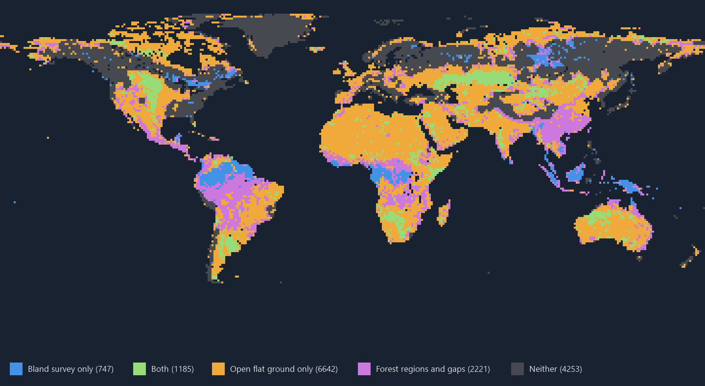

The bland survey reaches the great rainforests (the Amazon, the Congo, Borneo, New Guinea and the
Guianas) and patches of Siberian forest, where up close everything is the same dark green. The
open-ground list reaches the deserts (the Sahara, Arabia, Australia, the Gobi and Iran), the farm
belts (the Great Plains, the Po valley, Ukraine and southern Russia, India's plains and the Nile)
and the Arctic tundra. Both lists cover the Kazakh steppe, the northern Great Plains, the Pampas
and the Kalahari.

The purple squares come from a third list, `fill_squares.csv`, made by `make_fill_squares.ps1`.
It fills in whole rainforests that the bland survey only reached in patches (the Amazon, the
Congo, West Africa, Borneo, New Guinea and north Queensland), plus any square with at least 5 of
its 8 neighbours on a list. Without it, the detail switched from sharp to blurry along the edge
of a square, which showed as a straight line running through the Congo forest
(`limit_test/congo_fill.png`). If you change any of the lists, redraw this map with
`tools/terrain/draw_square_lists.ps1`.

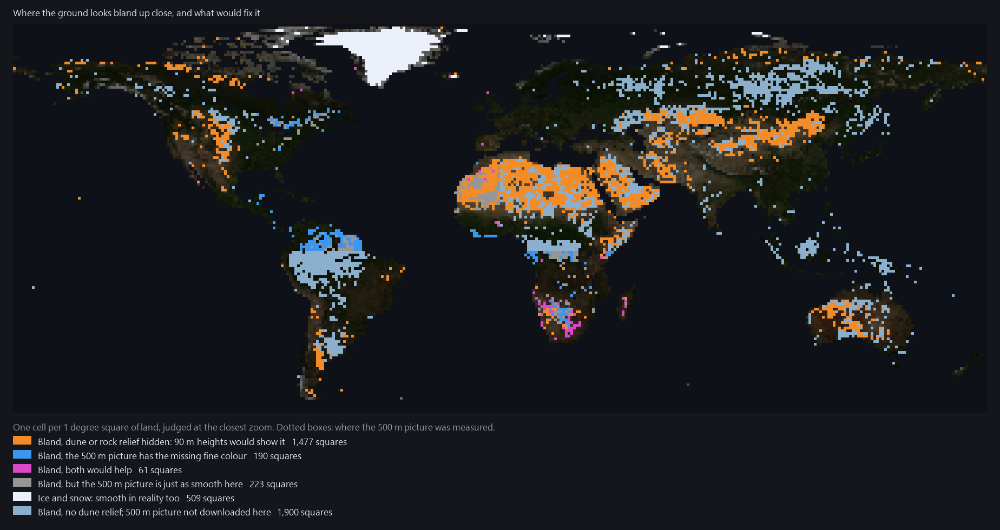

*The bland survey. There are more pictures, and the fixes it led to, in `docs/bland_survey`.*

### For the ground textures (`data/base/ground`, not really a pack)

#### 16. Close-up ground: textures cut from real satellite pictures

**The problem.** At the closest zoom, one pixel on your screen covers about 100 m of ground, but
the sharpest colour the map stores only has a point every 300 m. So up close the ground looked
soft, like a photo that's been blown up too far.

**Made-up detail was tried first, and didn't work.** The game could invent fine detail by itself
(procedural noise), which costs nothing to store. It was tried in the Sahara, the Kalahari and the
Alps. It looked fake, like a pattern stamped over the ground that didn't follow the real land, and
it cost 2 to 9 ms every frame. It's still in the shader, but switched off (`procedural_strength` 0).

| Plain | Made-up ridges |
| --- | --- |
| 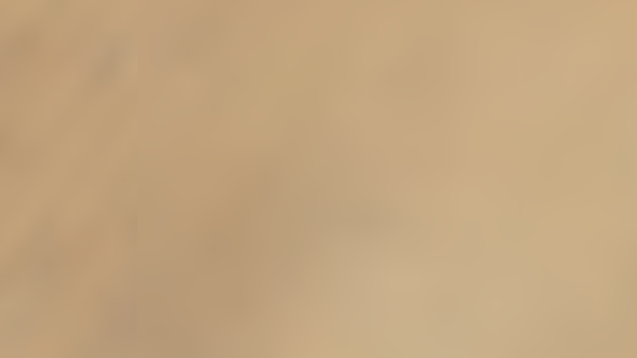 | 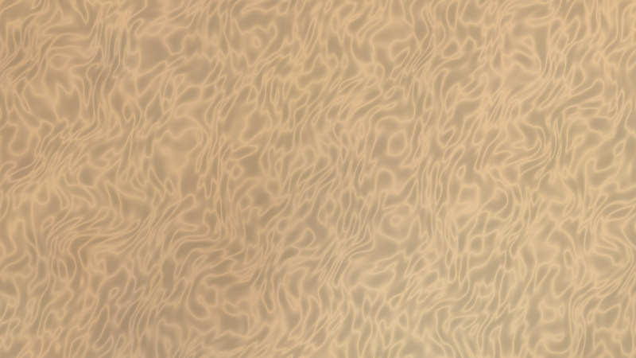 |

*The made-up ridges on the right look like a pattern laid on top of the ground, not like the
ground itself.*

**What's used instead: a texture of real ground for each kind.** Each kind of ground (farmland,
grassland, forest and so on) gets a texture cut from a real satellite picture of a typical place
of that kind. The picture is the Sentinel-2 one that ESA's WorldCover was made from, at 10 m a
pixel, and it's free to use (CC BY 4.0).

The texture only keeps the *fine* light and dark from that picture, anything smaller than about
500 m, and throws away everything coarser. For example, if one field in the Iowa sample is 15%
brighter than the ground around it, the texture brightens that spot by 15%. But if a whole county
is a little greener than the next, that's not in the texture at all. On average the texture is
exactly 1, meaning no change, so it never shifts the colour of the map. From further out, the map
looks the same with or without it; up close, it adds sharp field edges, gullies and the crowns of
trees.

It isn't accurate, and it isn't trying to be. Iowa's field pattern turns up on Ukrainian farmland
too, so it's not the real pattern of the place you're looking at. The goal is ground that looks
sharp and believable, not a map of every field.

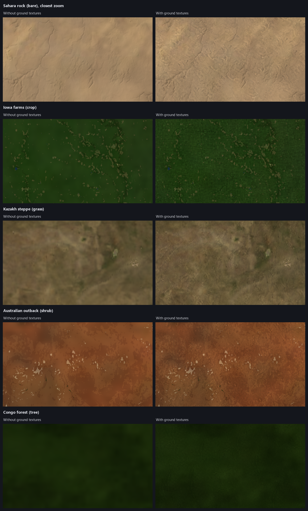

**How a texture is laid on the map.** One texture covers 88 km of ground, so at the closest zoom,
with about 270 by 150 km on screen, it would show up about five times. Laid down like floor tiles,
those copies would line up in a grid that your eye would spot straight away. So instead the map is
cut into hexagons, each about a quarter of a texture across (22 km), and each hexagon shows a
different piece of the texture:
- moved to a random spot in the texture,
- turned by up to 10° (no more, because fields and dunes run in a direction that a full turn
  would scramble),
- flipped east to west, north to south, both or neither (which keeps fields lined up with the
  compass),
- and shown anywhere from 0.75 to 1.33 times its size.

Where two hexagons meet, their patterns are blended in a way that keeps the contrast. A plain
average would wash the pattern out into a blur along every edge.

The textures fade in as you zoom: they start at about 500 km of visible map and are fully on by
about 250 km. Any further out they'd be too fine to see and would only slow things down.

**The samples have to be plain and typical.** The same texture is laid over every place of its
kind, so anything unusual in its sample shows up again and again. A single lake in the Kazakh
sample would put that same lake on every steppe in the world, about five times on one screen. The
first samples had exactly this problem: the Kazakh one had white salt pans, a road and some lake
shores, and they showed up as the same white marks stamped every 10 km.

So now each sample is chosen in two steps:

1. **A search** (`terrain samplepick`). For each kind of ground, it looks at the land cover map
   within a few degrees of a typical place and scores every 88 km square on it. It asks how much
   of the square is that kind of ground, whether every part of it is (a square that's all farmland
   on one side and all forest on the other scores badly), how little water there is, and how few
   towns and lakes (any 2 km patch that's mostly buildings or mostly water). The best square wins.
   For example, the Kazakh steppe square it chose is 99.8% grassland, with no water, towns or
   lakes. Ground that looks the same from above counts as belonging, like pasture between fields
   or grass between bushes.
2. **A look by eye.** Every square it picked was then looked at. The land cover map is too coarse to
   catch everything, and six of them still had something in them that would repeat, so those were
   moved by hand:

| Sample | What the search's square had in it | Moved to |
| --- | --- | --- |
| Latin American farmland | Dark strips of forest along every stream (Mato Grosso) | Paraná, Brazil |
| European farmland | Large woods west of Chartres | The open Beauce, France |
| Middle Eastern farmland | Irrigation circles, desert and a river (Harran, Turkey) | The Nineveh plain, Iraq |
| South Asian farmland | Semi-desert and a canal (Rajasthan) | Haryana, India |
| North American bushland | Canyons and pale badlands (Owyhee, Oregon) | The Oregon high desert |
| North American forest | White scars from mountaintop coal mining (West Virginia) | The forests of Pennsylvania |

The farmland samples still have their small villages in them. Every 88 km of farmland has some,
and they're part of what farmland looks like from above. The North China one has the most, just
like the real plain.

**Standout spots get toned down.** Even plain ground has a few spots that are much lighter or
darker than the rest, like a white salt pan out on the steppe, and those are exactly what your eye
catches when they repeat. So the texture maker eases back any light or dark that's much stronger
than the sample's usual variation. In the Kazakh sample, for instance, ordinary ground varies by
about ±8%. A salt pan that's 80% brighter than its surroundings gets cut down to about 20%
brighter, while the ordinary ±8% is left almost untouched (`terrain groundtex --soften`, which
softens anything beyond 2.5 times the usual variation; 0 turns it off).

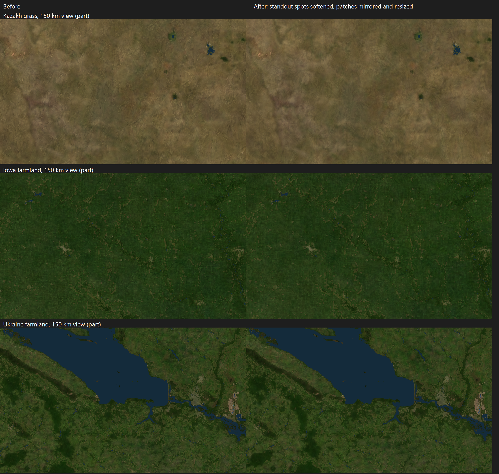

*The Kazakh steppe before (left) and after (right) softening: the repeated white marks are gone.*

**Why 88 km samples.** The first samples covered 44 km, so each one showed up about 20 times on a
single screen; at 88 km it's about five. The texture is still 1024 by 1024 pixels, so each pixel
now covers 86 m instead of 43 m. That doesn't cost any sharpness, because at the closest zoom a
screen pixel is about 100 m anyway, and it uses exactly the same graphics memory.

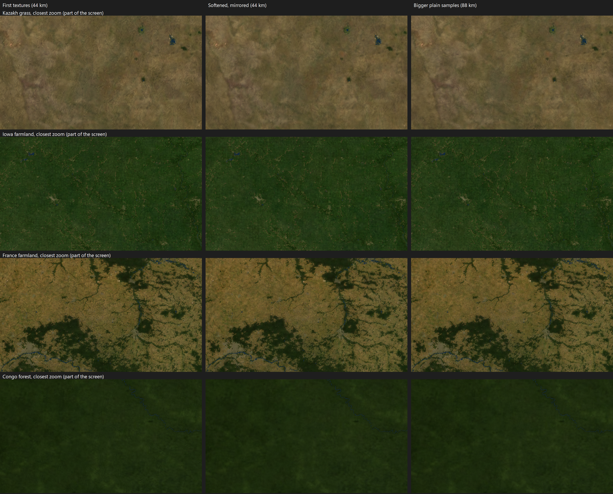

*From left to right: the first textures, the softened and mirrored ones, and the bigger, plainer
samples.*

**Which samples are used.** These are the standard textures, used everywhere unless a regional one
takes over:

| Kind | Sample place |
| --- | --- |
| Farmland | Iowa, 41.6° N 95.2° W |
| Grassland | Kazakh steppe, 47.7° N 71.8° E |
| Bushland | Australian outback, 28.05° S 133.4° E |
| Forest | Congo rainforest, 0.5° N 22.5° E |
| Wetland | Pantanal, Brazil, 18.5° S 56.5° W (44 km; see below) |
| Bare ground | None, because the heights already show the dunes (see below) |

Tundra, ice, towns, mangroves and water don't get a texture.

**Regional versions.** One place per kind doesn't fit the whole world. Iowa's grid of roads, a
mile apart, looked wrong on Indian or French farmland, for example. So some kinds have a version
for each region. A small map, `data/base/ground/regions.png`, has one pixel per 1° square, and it
says which region the square is in (roughly a continent) and, in a few places, a zone that crosses
regions (the northern forest belt). A zone's version wins over a region's, and a region's wins over
the standard one. So farmland in Finland is in the Europe region and gets the Beauce texture, but
forest in Finland is also in the boreal zone, so it gets the Russian forest texture instead of the
Congo one.

| Kind | Region or zone | Sample place |
| --- | --- | --- |
| Farmland | Europe | The Beauce, France, 48.25° N 1.65° E |
| Farmland | Northern Eurasia | Southern Russia, 48.75° N 41.7° E |
| Farmland | South Asia | Haryana, India, 29.6° N 75.55° E |
| Farmland | East Asia | North China plain, 32.8° N 114.8° E |
| Farmland | Southeast Asia | Thai rice paddies, 13.55° N 102.8° E |
| Farmland | Latin America | Paraná, Brazil, 22.75° S 54.15° W |
| Farmland | Sub-Saharan Africa | Northern Nigeria, 14.0° N 7.25° E |
| Farmland | Middle East and North Africa | Nineveh plain, Iraq, 35.95° N 42.55° E |
| Farmland | Australia | New South Wales, 34.4° S 147.2° E |
| Forest | Boreal zone (north of 52° N) | Russian forest, 59.65° N 47.5° E |
| Forest | North America | Pennsylvania, 41.65° N 78.35° W |
| Grassland | Africa and Latin America | Serengeti savanna, 2.55° S 35.05° E |
| Bushland | North America | Oregon high desert, 43.25° N 119.95° W |

Where two regions meet, you don't get a straight line. Each hexagon picks its version from a point
up to half a degree away from its centre, so hexagons of both versions mix together over about
100 km, and hexagons with different versions blend across their whole width.

The two were compared at the closest zoom, away from the sample places
(`ground_textures/standard_vs_regional_1.png` and `_2.png`). India's farmland lost the American
grid and got fields dotted with villages instead. Germany, Russia, Thailand, West Africa and
Australia got irregular fields instead of the grid. And the northern forest got a much richer
pattern than the Congo canopy. You can turn the regional versions off to compare, with
`RegionalGroundTextures` on the Terrain node or `-- --ground-standard`; once the choice is settled,
that switch can go.

To see every texture next to the sample it came from, look at
`ground_textures/textures_and_sources.png`, and for the regions in colour,
`ground_textures/regions_map.png`. Both are drawn by `tools/terrain/draw_ground_textures.ps1`.

**Wetland keeps a 44 km sample.** Wetlands are patchy everywhere. No 88 km square on Earth is more
than about 60% wetland, so a bigger sample would be half something else. Each kind's size is
written in `data/base/ground/sizes.txt` (for example `crop 88` and `wetland 44`), and the game
sizes each kind's hexagons to match. A kind's regional versions have to be the same size as its
standard one.

**Deserts don't get a ground texture.** Compared side by side, the slope shading from
the heights already showed the dunes (the sand seas have 90 m heights), and a texture added very
little (`ground_textures/deserts_heights_only.png`). Only rock plateaus like the Tassili lose a bit
of fine rock pattern. The work on desert textures is kept, but switched off (see below).

**What it costs.** Measured at 2560 by 1440 (`--pan-test` and `--memory-report`):

| | Without ground textures | With them |
| --- | --- | --- |
| Time per frame, closest zoom over Europe | 11.6 ms | 15.6 ms |
| Time per frame, country view (600 km) | 7.5 ms | 7.5 ms |
| Graphics memory | | About 25 MB more (787 MB in all) |
| Files in `data/base/ground` | | 19 PNGs, 39 MB |

The textures are compressed on the graphics card (BC7), with no difference you can see.
Compressing takes about 0.4 s per texture, so the game only does it once and keeps the result in
its user folder (`user://ground_cache`), redoing it when a texture file changes. The extra 4 ms is
spread across all the hexagon work: reading the textures, the random numbers, the region lookups
and the maths. Faster sine and cosine and fewer blur levels were tried, and neither saved anything
measurable.

**Switches for testing.** In the game, press **P** to turn the ground textures on and off; the
debug readout shows which. The screenshot test takes `--no-ground-textures`, `--ground-strength=N`,
`--ground-plain` (laid like floor tiles, without hexagons), `--ground-standard` and
`--ground-uncompressed`. On the map material there's `ground_texture_strength`, and
`ground_texture_far_km`, which sets the zoom where they start, in km per pixel.

**Things that went wrong along the way:**
- The first try drew everything sheared, leaning about 47° in Iowa. East was being measured from
  0° longitude, and that leans more the further away you get. Now each hexagon lays its piece flat
  around its own centre, and the hexagon grid starts over every 30° of longitude. The pattern
  changes along those 12 lines, but you can't notice it.
- The first Middle East sample, from the Nile delta, put a thin fake river across Iraq's farmland.
  The delta's branches are 30 to 40 km apart, so any square there has one in it.
- Mirroring on its own didn't stop the repeats. Toning down the standout spots did.

**Kinds of desert (switched off).** The land cover map has just one class, bare ground, for sand
seas, rock plateaus, gravel plains and salt flats, so a single desert texture put rock blotches on
smooth sand. Before deserts lost their texture, each bare 1° square was matched to the desert
sample it looked most like, judged by how much fine texture, brightness, redness and relief its
500 m picture has (`make_ground_regions.ps1`). That way star dunes got the star dune texture,
gravel plains got the gravel one, and so on. Run `make_ground_textures.ps1 -Pick "...,bare=bare_rock"`
and it all comes back:

| Desert sample | Place | Squares |
| --- | --- | --- |
| Gravel with rocky hills | Gobi, 42.5° N 104.5° E | 514 |
| Rock plateau | Tassili, 25.5° N 9.5° E | 484 |
| Linear dunes with outcrops | Erg Chech, 24.5° N 2.5° W | 306 |
| Smooth sand sheet | Selima, 21.5° N 29.5° E | 269 |
| Rows of dunes | Taklamakan, 38.5° N 83.5° E | 134 |
| Gravel plain | Tanezrouft, 23.5° N 0.5° E | 102 |
| Great crescent dunes | Rub al Khali south of Liwa, 22.5° N 54.5° E | 96 |
| Star dunes | Grand Erg Oriental, 30.5° N 7.5° E | 74 |
| Red dunes with a few outcrops | Namib, 25.25° S 15.25° E | 63 |
| Long dune ridges | Great Sand Sea, Egypt, 26.5° N 25.5° E | 43 |

Salt flats couldn't be told apart from bright gravel this way, so Iran's salt flats would get the
Gobi texture; fixing that would need a map of salt flats. The Rub al Khali texture keeps light and
dark up to 2 km instead of 500 m (`--blur-for bare_sand_sea=2000`), because its dunes are 1 to 3 km
apart. These desert samples are all 44 km, so if deserts ever get textures again, they'll need the
same 88 km treatment as the others.

## 1. The tile system

Every kind of terrain data is stored the same way, and that's what makes it possible to put detail
only where it's needed.

- **Tiles and levels.** The world is cut into square tiles of latitude and longitude. Level 0 is
  just two tiles, the western and eastern halves of the world, and each level down cuts every tile
  into four:

  | Level | Tile size | Distance between points (north to south) |
  | --- | --- | --- |
  | 3 | 22.5° | 9.8 km |
  | 5 | 5.6° | 2.4 km |
  | 6 | 2.8° | 1.2 km |
  | 7 | 1.4° | 611 m |
  | 8 | 0.7° | 305 m |
  | 9 | 0.35° | 153 m |

- **Only where it matters.** A finer tile is stored only where it would visibly change the
  picture. Everywhere else, the game draws that area from the coarser tile above it.
- **Packs.** A pack is a folder of tiles named `<level>/<x>/<y>.<ext>`, plus a `pack.json` that
  records how it was baked. "The packs", near the top of this document, describes what each of
  the five holds and what it's made from.
- **File formats** are described at the top of `src/Core/Terrain/HeightTile.cs` (heights) and
  `src/Core/Terrain/SurfaceTile.cs` (the other four). They're all compressed, and colour and detail
  are stored as JPEG pictures inside the tile.
- **Maps** of which level each pack stores where, and of the measurements that decided it, are in
  `docs/detail_maps` (see decision 1). Each pack's `decisions.csv` holds those measurements, one
  row for every tile a bake looked at, whether it was kept or not.

### How the packs are combined

The game reads all five packs (described in "The packs" near the top) for every point it draws.

**How a point is drawn:**

1. **Water** decides whether the point is land or sea, and where the coast is.
2. **Sea** is coloured using the sea shade from the distant colour pack.
3. **Land** takes its colour from the distant colour pack when you're far away, and from the land
   cover pack up close. "Up close" means wherever the land cover's points are at least about half
   a pixel apart on screen: below roughly 250 km of visible map where the land cover is finest (in
   mountains), and up to about 900 km where it's coarsest. In between, the two blend smoothly, and
   they agree on average, so nothing jumps as you zoom.
4. **Detail** then multiplies the land colour, near or far.
5. **Heights** shade the result: slopes facing north-west get brighter, slopes facing away get
   darker. Up close, they also lift the mountains.

**Distant colour and detail do different jobs.** Distant colour is the average colour of the kinds
of ground at a place, worked out from the land cover. If a point is 70% forest and 30% grass, it
gets 70% of the forest colour and 30% of the grass colour. It never looks at the satellite photo of
that point at all. So inside a big area of one kind, like a desert that's all "bare", every point
gets the same colour and the whole area turns into one smooth blur. Detail is the correction: it's
how much the satellite photo differs from that average, point by point. The game multiplies the
two together. Detail is never drawn on its own, and it's used both near and far, on top of
whichever land colour is being drawn.

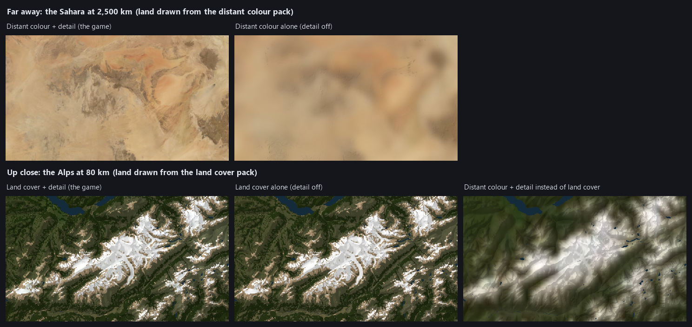

*Top: the Sahara from 2,500 km. Distant colour on its own is a smooth blur, and the detail adds
the plateaus, sand seas and wind streaks. Bottom: the Alps from 80 km. Up close, the land cover
draws the ground (left), and the detail doesn't change much here, because it fades out on steep
slopes where the photo's own shadows would clash with the slope shading. On the right is the
distant colour drawn up close instead, to show why the land cover takes over near the ground.*

These pictures were taken with the screenshot test's `--no-detail` and `--no-cover` switches. There
are two more: `--no-relief` turns off the slope shading, and `--no-distant-colour` replaces the
land's distant colour with plain grey.

**How distant colour and detail are made**, following one spot in a desert as an example:

1. **A colour for each kind of ground, place by place.** Before anything else, the tool takes the
   2 km NASA picture and, every quarter of a degree around the world, averages the colour of all
   the pixels within about 30 km that WorldCover calls each kind. Around the spot, all the "bare"
   pixels average out to a sandy tan. Averaging over that much ground cancels out the photo's
   shadows. The result is `cover_colours.png`.
2. **Distant colour: the mix of kinds.** For every point of the finest tiles, the tool counts the
   WorldCover pixels under it by kind and mixes those kinds' colours in proportion, so 70% forest
   and 30% grass gives 70% forest colour and 30% grass colour. The spot is 100% bare, so it gets
   the tan. The coarser tiles are averages of the finer ones, and levels 0 to 6 are stored (down to
   7 on open ground). The sea's shade comes from its depth instead. Nothing from the satellite
   photo is copied in.
3. **Detail: the photo divided by the mix.** For each pixel of the satellite photo (2 km, or
   500 m in the squares that use the sharper one), the tool works out the same mix of colours for
   the ground under it, then divides the photo's real colour by that mix. The spot sits on a dark
   rock plateau that's about 60% as bright as the tan, so its detail is about 0.6 in red, green
   and blue. Over red sand nearby it might be 1.1 for red, 0.95 for green and 0.85 for blue. The
   detail is eased towards 1 on steep slopes, where the photo's shadows are, and in the far north,
   and points that are mostly water are filled in from their neighbours.
4. **In the game: multiply them back together.** Tan times 0.6 is the dark plateau again. From far
   away, distant colour times detail gives back the satellite photo's colours, minus its shadows
   on the slopes. Up close, the land cover's own colours take the place of the tan, and the same
   detail multiplies those.

**Why the detail doesn't just do the distant colour's job.** Detail is only the difference from
the average, so on its own it's a grey map with faint marks on it. Forest and desert look the same,
because each is close to its own kind's average.

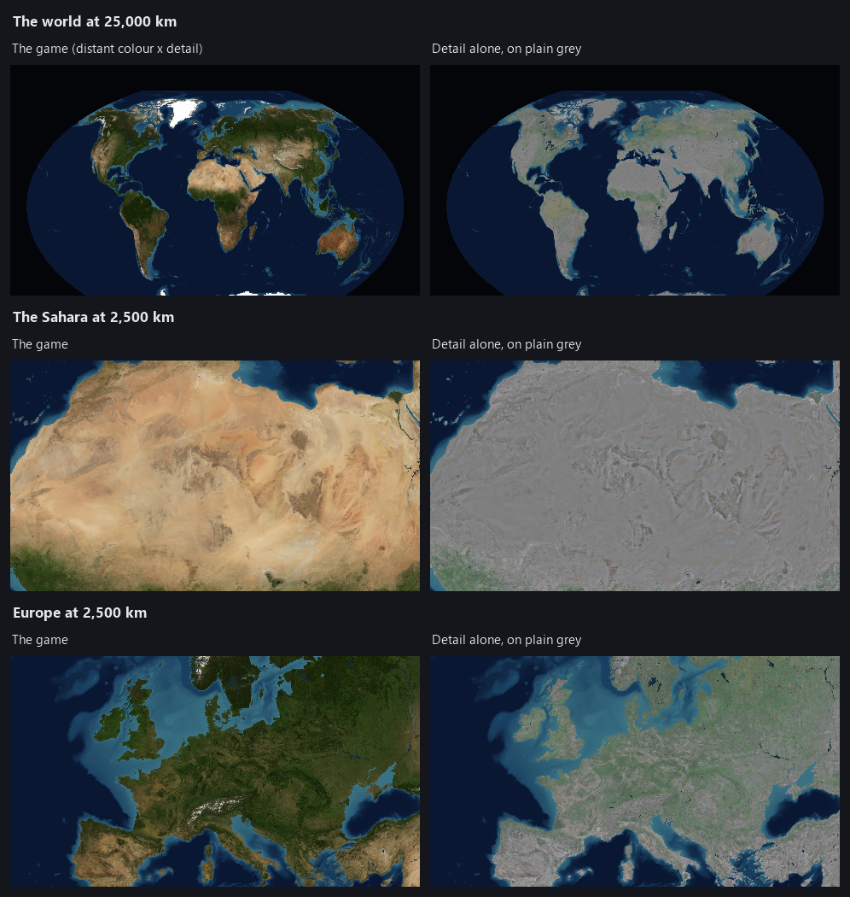

You could store the satellite photo's real colour instead of a difference, and then one pack would
do both jobs from far away. But that's the design the game moved away from, for three reasons:

- **Up close, it couldn't sit on top of the land cover.** The close-up view draws each kind of
  ground with its own colour and clean edges. A difference can be multiplied onto any of those
  colours, but a real colour would replace them, and that brings the blurry satellite photo back.
- **The photo has shadows in it.** The mountains in the photo are lit by the real sun, and those
  shadows clash with the game's slope shading. The kinds' colours are averaged over about 30 km so
  their shadows cancel out, and the detail fades out on steep slopes.
- **The photo has gaps.** Blue Marble is plain white north of 80° N, whereas the land cover covers
  the whole world, thanks to the Arctic fill.

Folding the detail into the distant colour wouldn't save anything either. The close-up view still
needs the detail as a multiplier, and it reads the coarser detail tiles wherever there aren't finer
ones. Keeping them apart also helps modding: you can repaint a kind's colour in `cover_colours.png`
and the detail still applies on top.

You'll find `cover_colours.png` in `tns-godot/data/base/cover/`, but the Godot editor won't show it.
The `data/` folder has a `.gdignore` file so that Godot doesn't try to import 2 GB of tiles, so
open the folder in Explorer or Finder instead.

## 2. Lists and caches made from the raw data

The sources themselves, what each one gives and how to get it, are listed in "The raw data
sources" near the top of this document. This section covers the smaller files made from them.

**Square lists**, in `tools/terrain/lists/`. These are small files, kept in git so a bake can be
repeated exactly:

| File | Made by | What it's for |
| --- | --- | --- |
| `rugged_squares.txt` | `terrain rugged` | The 2,000 steepest 1° squares, which get Copernicus heights |
| `relief_squares.txt` | `terrain bland` | 632 dune and rock squares with the most hidden relief, which also get Copernicus heights |
| `relief_squares_all.csv` | `terrain bland` | 1,538 squares with hidden relief. ETOPO goes one level finer there, and their height detail is always kept |
| `detail_fine_squares.csv` | `terrain bland`, `terrain blandmap --list` | 2,083 squares where at least 2 of 9 patches look bland and the 500 m Blue Marble helps |
| `open_squares.csv` | `make_open_squares.ps1` | 8,769 squares of open ground that isn't mountains, where the colour goes to level 7 and the detail to level 8 |
| `fill_squares.csv` | `make_fill_squares.ps1` | 2,496 squares: whole rainforests the bland survey only reached in patches, and gaps in the lists |

The ground texture samples are chosen from two small files in `tools/terrain`. `sample_sites.csv`
has a typical place for each sample and how far around it to search, and `sample_windows.csv` has
the squares `terrain samplepick` chose, which `download_s2_windows.ps1` then downloads.

**Caches**, in `terrain-sources/`. If you delete these, they're made again automatically:

| File | Made by | What it's for |
| --- | --- | --- |
| `surface_colours.bin` and `.png` | `terrain surface` | The measured colour of each kind of ground |
| `detail_survey.csv` | `terrain plan` | Measurements for predicting how big a height bake will be |

## 3. Baking the heights

```
cd tns-godot/tools/terrain
dotnet TerrainTool/bin/Release/net8.0/terrain.dll bake recipes/base_earth.json --output ../../data/base/terrain-new
```

The recipe stacks three sources on top of each other. Where more than one has data, the later one
wins:

| Source | Where | Finest level |
| --- | --- | --- |
| ETOPO | The whole world | 7 (611 m) |
| ETOPO again | Only in `relief_squares_all.csv` | 8 (305 m) |
| Copernicus | Its 2,619 squares | 9 (153 m) |

Here's what the tool does:

1. **Finest tiles first.** In each part of the world, it goes down to the finest level any source
   has data for and reads the heights there.
2. **Then the coarser tiles.** Each tile above is an average of the four below it. The edges of
   neighbouring tiles are averaged in the same way, so they always meet exactly.
3. **Keep only what shows.** A tile is only saved if its slopes differ from what the coarser tile
   would draw by more than 6 m in 100 m (`detailSlope`) over more than 800 km² of ground
   (`detailAreaKm2`). There are two exceptions: levels 0 to 3 are always complete, and the squares
   in `relief_squares_all.csv` always keep their full detail (decision 7).
4. **Rounding.** Heights are rounded to 2 m, which compresses well. Anything below sea level is
   raised to 0, because the water pack draws the water.

The result is `data/base/terrain`: 30,145 tiles, 1.18 GB, in about 18 minutes. Bake into a new
folder with `--output` and swap it in when it's done, so the game keeps working in the meantime.

Where does the time go? Measured on 2026-11-18 with timers in the baker, 84% of it is
compressing the 30,145 tiles that are kept. Tiles are compressed with zlib at its slowest,
"smallest size" setting, which takes about 175 ms a tile. Zlib's normal setting takes 8.5 ms and
makes the files 4% bigger (`terrain bench ../../data/base/terrain` compares the settings on real
tiles). Reading the sources for all 93,700 tiles the tool builds while deciding what to keep is
only 14% of the time, and the open sea within that, which a check could skip, is 3.5%.

`terrain plan` can predict in seconds how big the pack would be with different `detailSlope` and
`detailAreaKm2` values.

## 4. Baking the ground

```
dotnet TerrainTool/bin/Release/net8.0/terrain.dll surface recipes/base_surface.json
```

Bake the heights first, because in mountains the land cover goes as deep as the heights do.

1. **Measure the colour of each kind of ground** from Blue Marble, place by place, over about
   30 km (decision 12). The result is saved in `surface_colours.bin`, and `--recolour` measures it
   again.
2. **Make the finest tiles from the land cover.** For every point, the WorldCover pixels under it
   give the most common kind of ground (for the cover pack), how much of it is water (for the water
   pack) and the blended colour of the land (for the surface pack).
   - Where WorldCover has nothing (the open sea, Antarctica, and everything north of about
     82.8° N), the heights decide what's land and what's sea. North of 82.8° N the kind of land
     comes from `worldcover_arctic` (`landCoverFill` in the recipe), and in Antarctica it's snow.
   - The sea's shade comes from its depth in ETOPO, and water more than 25 m above sea level is a
     lake.
3. **Build the coarser tiles and keep only what shows**, separately for each pack:

   | Pack | Levels | Saved where |
   | --- | --- | --- |
   | cover | 7 and 8, plus 9 in hills and mountains (one level finer than the heights) | The kind of ground changes over more than 20 km² |
   | water | 0 to 9 | The coast would move over more than 1 km² |
   | surface | 0 to 6, plus 7 on open ground that isn't mountains (`open_squares.csv`) | The colour changes noticeably over more than 100 km² |

4. **The colour detail** (decision 14). For every point, the real Blue Marble colour is divided by
   the colour its kinds of ground predict and saved as a multiplier. It goes down to level 6
   everywhere from the 2 km photo, and to level 8 from the 500 m photo in the squares listed in
   `detail_fine_squares.csv`, `open_squares.csv` and `fill_squares.csv`. It fades out on steep
   slopes, and north of 79.5° N, where Blue Marble is plain white (`pictureNorthLimit`).

The result, in `data/base`, is `cover` 415 MB, `water` 331 MB, `surface` 153 MB and `detail`
655 MB, and it takes about 30 minutes: 21 for the first three and 9 for the detail. Measured on
2026-11-18, about half the time goes on averaging, measuring, compressing and writing the coarser
tiles. The biggest part of that is compressing the land cover and water tiles at zlib's slowest
setting, which takes 32 ms and 8 ms a tile, against 2 ms and 1 ms at the normal setting, for files
9% and 5% bigger. Building the 204,072 level 9 tiles from WorldCover, the heights and the colours
takes 44%, and about 14% is the open sea within that, which a check could skip.

Some useful options:
- `--detail-only` redoes just the colour detail, in about 3 minutes.
- `--update west,south,east,north` rebakes one area of the real packs after its data has changed
  (about 2 minutes for a country-sized box) and leaves the rest of the map alone.
- `--region west,south,east,north` paints one area into empty folders, for trying out settings
  quickly. Never use it on the real packs.
- `terrain preview` draws an area from the packs as a picture, without starting the game.

## 5. Choosing where detail goes: the bland survey

`terrain bland` scores every 1° square of land the way the game draws it at the closest zoom: how
much of it looks like a smooth, featureless wash. For the bland squares, it then checks what
better data would add, either hidden relief in the heights (dunes, rocky plateaus) or finer colour
from the 500 m Blue Marble. The square lists in section 2 come from it, and `terrain blandmap`
draws the result (`docs/bland_survey`). Run it again after a bake to see what's still bland.

## 6. How the game uses the packs

The code is in `src/Map/Terrain/TerrainRenderer.cs` and `shaders/map/map_terrain.gdshader`.

- **Loading.** When it starts, the game finds the tiles in `data/base/<pack>`, then in
  `mods/<name>/<pack>` for each mod, in order of name. A mod's tile replaces the base tile in the
  same place.
- **Choosing tiles.** Every frame, it works out which tiles the camera needs, and switches to a
  finer one wherever a tile would be more than 256 pixels wide on screen and a finer one exists.
  Tiles load from disk in the background, and until one arrives the coarser tile above is drawn in
  its place, so there are never any holes.
- **Deciding whether a tile is on screen.** For each tile, the game projects nine points (a 3 by 3
  grid) plus the point nearest the view target, and keeps the tile if the box around them overlaps
  the screen with a 15% margin. Points beyond the horizon still count towards that box. They used
  not to, and when the camera was tilted, a big tile reaching over the horizon could have all its
  near points off screen, so the whole tile was dropped and a strip of ground next to the horizon
  went missing. That showed as tiles popping in and out at the edge of the screen while tilting.
  `--tilt-sweep` with the screenshot test checks for this (see the README).
- **Fast loading.** A quality setting that loads fewer tiles: coarser tiles towards the edges of
  the screen and the horizon, and no extra-sharp distant colour or colour detail (levels 7 and 8),
  while the middle of the screen, the heights, land cover and coasts keep full detail. **O** toggles
  it in the game; the README has the measurements.
- **Graphics memory.** Each pack has a fixed number of slots on the graphics card, about 400 MB in
  all. When the slots are full, the tile that was used least recently makes room.
- **What you see at each zoom:**

  | Zoom (height of the visible map) | What you see |
  | --- | --- |
  | Over 9,000 km | A flat map (in the Winkel tripel projection), drawn from the blended colour and the water |
  | 9,000 to 3,500 km | The map folds into a globe |
  | 3,500 to 2,200 km | The mountains rise to their true height |
  | About 800 to 250 km, at 2560 by 1440 | The land cover fades in over the blended colour, with each kind of ground drawn with clean edges and coloured from `cover_colours.png`. The fade is long on purpose (`cover_fade_km`), so the change is gradual. That includes the land cover being a little darker, because small bright towns and roads are in the 160 m data the blended colour is mixed from, but often get lost from the 611 m land cover tiles |
  | About 500 to 250 km and closer | Ground textures cut from real satellite pictures fade in and add fine light and dark: field edges, gullies, the crowns of trees (decision 16) |
  | Always | The colour detail, slope shading lit from the north-west, the coasts from the water pack, and the sea shaded by its depth |

  Settings worth knowing about, on the terrain material: `cover_sharpness` (how crisp the edges
  between kinds of ground are), `cover_fade_km` (where the land cover starts and finishes fading
  in, in km per pixel), `ground_texture_strength`, the sea colours `sea_shallow`, `sea_shelf`,
  `sea_deep` and `lake_colour`, and `procedural_strength` (made-up fine detail, which is off; see
  decision 16).

## 7. Rebuilding everything from scratch

To just run the game on a new computer, there's no need to rebuild anything: the baked packs are
attached to a GitHub release, and `tools/terrain/download_packs.ps1` downloads and unpacks them
(see "Running" in the README). After a rebake, `make_pack_release.ps1` publishes the new packs the
same way ("Sharing the baked packs" in `tools/terrain/README.md`).

To rebuild the packs themselves on a new computer, from `tns-godot/tools/terrain`, with .NET 8 and
GDAL installed (these steps are for Windows):

1. `download_etopo2022.ps1` (about 5 GB)
2. `download_worldcover.ps1` (about 1 GB)
3. `download_bluemarble500.ps1` (351 MB, which becomes 1.9 GB once converted)
4. Put the 2 km Blue Marble in `terrain-sources/bluemarble_2km` (from the Unity project or from
   NASA), or point `colourImage` in `base_surface.json` somewhere else.
5. `download_copernicus90.ps1 -List lists\rugged_squares.txt`, then again with
   `-List lists\relief_squares.txt` (about 10 GB in all). New lists come from `terrain rugged`, run
   on a bake made with ETOPO only, and from `terrain bland`.
6. Unzip the Natural Earth glacier outlines into `terrain-sources/natural_earth`, then run
   `make_arctic_cover.ps1`, which takes a few seconds.
7. `dotnet build -c Release TerrainTool`
8. `terrain bake recipes/base_earth.json` (about 18 minutes)
9. `terrain surface recipes/base_surface.json` (about 30 minutes)
10. Check the result: run the game's screenshot test and `--surface-tour`, and redraw both maps for
    each pack into `docs/detail_maps` with `terrain map` and `terrain decisions`.

The ground textures have their own steps, described under "Close-up ground textures" in
`tools/terrain/README.md`.

## 8. Modding

A mod is a folder in `mods/` containing any of the same pack folders (`terrain`, `cover`, `water`,
`surface`, `detail`). Its tiles replace the base ones, and it only needs the tiles it changes.

- **Heights** are easy. Use `terrain export` to save an area as a GeoTIFF height image, edit it in
  any image editor, then bake it over the base pack with `onlyBounds` (see `tools/terrain/README.md`).
  You don't need any raw data for this.
- **The kind of ground** is harder for now. Repainting the land cover means editing WorldCover's
  images and rebaking (with `--update`, just for that area), and the colour detail still remembers
  the real ground that was there. A land cover export and a "flatten detail" option would make this
  easy, but they haven't been built yet.
- **The colour of each kind of ground** can be changed by repainting `cover/cover_colours.png`, or
  with `classColours` in the surface recipe.
- **A ground texture** can be replaced with the mod's own `ground/<kind>.png` next to its `cover`
  folder, plus a line in `sizes.txt` saying how much ground it covers (for example `crop 88`).

## 9. Shipping

The game only needs `data/base/{terrain, cover, water, surface, detail}`, about 2.7 GB, plus the
39 MB of `data/base/ground`. Godot doesn't export `data/` (it has a `.gdignore` file), so a release
has to copy it next to the game's executable, along with an empty `mods/` folder. Leave out any
backup packs (`-prev`, `-old`, `-before-...`), the `decisions.csv` file in each pack (11 MB of
records for people, which the game never reads), and everything in `tools/`, `docs/` and
`terrain-sources/`.
